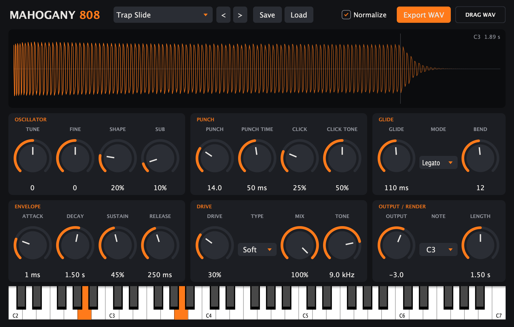

<div align="center">

# Mahogany 808

**Design 808s, play them, and drop them straight into your beat.**

A free VST3 instrument for shaping 808 bass: tune it, punch it, distort it, slide it,
then export the one-shot as a WAV or drag it right into FL Studio.

[**Download the latest release**](../../releases/latest)



</div>

## Features

- **Play it or bounce it.** Use it as a live instrument from your keyboard or piano roll, or render the current 808 to a 24-bit WAV with one click.
- **Drag and drop.** Grab the **DRAG WAV** chip and drop it into FL Studio's playlist or channel rack. No saving or browsing needed.
- **Live waveform.** The preview redraws as you turn knobs, so you can see the tail, the release point and any clipping.
- **Real 808 behaviour.** It's monophonic with last-note priority, and legato glide slides only when notes overlap, the trap style.
- **Five drive types.** Soft, Hard, Tube, Fold and Crush, run at 4x oversampling to keep the distortion clean.
- **8 factory presets.** They also appear in FL's own preset menu. You can save and load your own `.808preset` files too.
- **Right-click to reset.** Right-click any control to snap it back to the current preset's value (Ctrl-click on a Mac trackpad).
- **What you hear is what you export.** Playback and WAV export share the same engine, so they sound the same.

## Install

Download the zip for your system from the [Releases page](../../releases/latest) and unzip it.

### Windows

1. Copy `VST3\Mahogany 808.vst3` into `C:\Program Files\Common Files\VST3\`.
2. In FL Studio, open **Options > Manage plugins**, click **Find plugins**, and look for **Mahogany 808** under **Generators**.

### macOS

1. Copy `VST3/Mahogany 808.vst3` into `~/Library/Audio/Plug-Ins/VST3/`.
2. The plugin isn't notarized by Apple yet, so macOS blocks it after download. Run this once in Terminal:
   ```bash
   xattr -dr com.apple.quarantine ~/Library/Audio/Plug-Ins/VST3/"Mahogany 808.vst3"
   ```
3. Rescan plugins in your DAW. In FL Studio that's **Options > Manage plugins > Find plugins**.

Mahogany 808 ships as VST3 only, so it works in FL Studio, Ableton Live, Bitwig, Reaper, Studio One and other VST3 hosts. Logic Pro and GarageBand need Audio Units, which aren't included.

### Standalone app

Each zip also includes a standalone version (`Mahogany 808.exe` / `Mahogany 808.app`). You can design 808s with it without opening a DAW. Pick your audio and MIDI devices in its settings.

## Quick start

1. Pick a preset, like **Trap Slide** or **Classic 808**.
2. Play some notes on the on-screen keyboard or your MIDI controller.
3. Shape the sound. **Punch** gives it the knock, **Decay** sets how long it rings, **Drive** adds grit.
4. Set **Note** and **Length** in the Output / Render section to choose what gets exported.
5. Hit **Export WAV**, or drag the **DRAG WAV** chip into your project.

Note names follow FL Studio, where middle C is **C5**.

## Controls

| Section | Control | What it does |
|---|---|---|
| **Oscillator** | Tune / Fine | Pitch offset in semitones and cents |
| | Shape | Rounds the sine toward a square for a harder, more audible 808 |
| | Sub | Adds a sine one octave below |
| **Punch** | Punch / Punch Time | How far the pitch drops at the start of each hit, and how fast |
| | Click / Click Tone | A short filtered transient for attack, and how bright it is |
| **Glide** | Glide | Slide time between notes |
| | Mode | **Off**, **Legato** (slides only when notes overlap) or **Always** |
| | Bend | Pitch-bend range in semitones |
| **Envelope** | Attack / Decay / Sustain / Release | Use Sustain at 0 for one-shots, or raise it for long held 808s |
| **Drive** | Drive / Type | Distortion amount and flavour: Soft, Hard, Tube, Fold or Crush |
| | Mix | Blend between clean and distorted |
| | Tone | Low-pass filter to tame the top end |
| **Output / Render** | Output | Output level in dB. The waveform warns you when it clips |
| | Note / Length | Which note and how long a hold to render for export and preview |

Export options: tick **Normalize** to bring exports up to -0.3 dB peak.

## Tips

- **Want a smoother 808?** Lower **Shape** and **Drive**, or switch Drive to **Soft**. Bringing **Tone** down to 3–5 kHz softens the buzz on the attack.
- **Want it to cut through on phone speakers?** Raise **Shape** a little, or add some **Drive**. That adds harmonics that small speakers can reproduce.
- **For trap slides**, set Glide Mode to **Legato** and overlap your notes in the piano roll.

## Building from source

Mahogany 808 is built with [JUCE](https://juce.com/) 8 and CMake. JUCE is downloaded automatically during the first configure step.

**Requirements:** CMake 3.22+, Git, and a C++17 compiler. On Windows that's Visual Studio 2022 with the *Desktop development with C++* workload. On macOS it's Xcode or the Command Line Tools.

### Windows

In a *Developer PowerShell for VS 2022*:

```powershell
cmake -S . -B build -G "Visual Studio 17 2022" -A x64
cmake --build build --config Release --target Forge808_VST3 Forge808_Standalone
```

### macOS / Linux

```bash
cmake -S . -B build -DCMAKE_BUILD_TYPE=Release
cmake --build build --config Release --parallel
```

Linux also needs: `libasound2-dev libx11-dev libxrandr-dev libxinerama-dev libxcursor-dev libxext-dev libxcomposite-dev libfreetype-dev libfontconfig1-dev`.

Builds end up in `build/Forge808_artefacts/Release/` (`VST3/` and `Standalone/`).

### Tests

`Forge808Tests` is a headless test program. It checks tuning (A1 = 55 Hz), legato glide, every preset's WAV export, state save/restore and right-click reset, and saves a screenshot of the UI:

```bash
build/Forge808Tests_artefacts/Release/Forge808Tests test-output   # use xvfb-run on headless Linux
```

## Releases

GitHub Actions builds Windows, macOS (Universal) and Linux on every push. To publish a release, bump `VERSION` in `CMakeLists.txt`, then push a matching tag:

```bash
git tag v0.1.0
git push origin v0.1.0
```

The workflow then creates a GitHub Release with a zip for each platform attached.

## Project layout

| Path | Contents |
|---|---|
| `Source/Engine808.h` | The DSP: voice, mono note and glide logic, oversampling, and the offline renderer shared by playback and export |
| `Source/PluginProcessor.*` | Parameters, presets, state and WAV writing |
| `Source/PluginEditor.*` | The UI |
| `tests/RenderTest.cpp` | Headless tests |
| `.github/workflows/build.yml` | CI builds and releases |

## License

Mahogany 808 is free and open-source software, licensed under the [GNU AGPL v3](LICENSE). You're free to use it in your music, commercial releases included. The license covers the plugin's code, not the sounds you make with it. If you share a modified version of the plugin, you must release your source code under the same license.

## Credits

Made by **Mahogany**. Built with [JUCE](https://juce.com/), used under its AGPLv3 open-source license.
